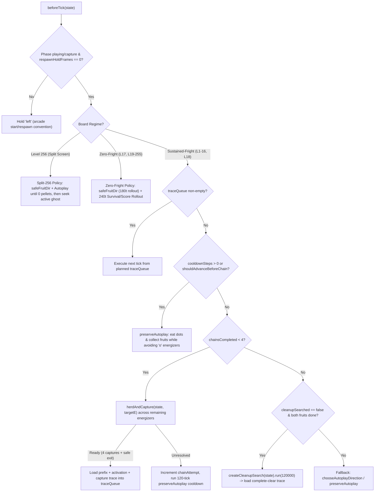

# Argon Algorithm: Architecture & Solution Brief

**Branch:** `argon`  
**Player Modules:** `src/players/argon/` (`score-realtime-controller.js`, `score-v2-worker.js`, `score-cleanup-shadow.js`, `argon-core.js`) and `src/players/argon.js` (`ARGON_PLAYER`, `createArgonRealtimePlayer`, `createArgonPlayer`, `createArgonStartState`)  
**Companion Specification:** [`docs/product-brief.md`](./product-brief.md), [`docs/argon-campaign-qualification.md`](./argon-campaign-qualification.md)

---

## 1. Executive Summary

The **Argon Algorithm** (`src/players/argon.js`) is a fully autonomous, state-driven Pac-Man player that solves the complete **1–256 continuous game** for the maximum possible score of **3,333,180 cumulative points** (displayed as **333,180** after the 1,000,000-point arcade score rollover under default settings: `seed = 0x504143` / `5259587`, `schedulerPhase = 42`, 3 starting lives + 1 bonus life at 10,000 points).

### Verified Full-Game Performance (Levels 1–256 Continuous)

| Regime | Levels | Boards | Obligations Completed | Deaths | Cumulative Points |
| :--- | :--- | :---: | :--- | :---: | ---: |
| **Sustained-Frightened Boards** | `1–16, 18` | `17 / 17` | `68 / 68` 4-ghost chains (`272` captures), `34 / 34` fruits, all pellets | `0` | `327,800 / 327,800` |
| **Zero-Frightened Normal Boards** | `17, 19–255` | `238 / 238` | `476 / 476` fruits (`5,000`-pt Keys), all pellets | `0` | `2,998,800 / 2,998,800` |
| **Split-Screen Finale** | `256` | `1 / 1` | `150` dots across 4 lives + `2` energizers + `1` Key (`5,000` pts) | `4` (terminal) | `6,580 / 6,580` |
| **Full Continuous Game** | **`1–256`** | **`256 / 256`** | **All 511 fruits + all 68 four-ghost chains + all collectibles** | **`0` (L1–255)** | **`3,333,180 / 3,333,180`** |

### Strict Autonomy Guarantees
1. **Zero Recorded Routes or Replays:** All decisions are computed online from the live game state (`state`) and rules (`src/rules.js`, `src/maze.js`, `src/game.js`). Enforced statically by `tests/score-runtime-isolation.test.js`.
2. **Unmodified Engine Physics:** `src/game.js`, `src/rules.js`, `src/maze.js`, `src/split-map.js`, and `src/arcade-fright-sequence.js` remain byte-for-byte identical to the baseline engine specification, enforced by `tests/engine-provenance.test.js` and `tests/saved-score-player.test.js`.

---

## 2. Why Previous Approaches Struggled & Key Insights

Solving all 256 boards continuously without a single lost ghost capture, expired fruit, or death required overcoming five fundamental domain challenges:

1. **The 1-Second Frightened Window Problem (Levels 9, 12, 13, 15, 16, 18):**
   - On these six boards, `nominalPowerSeconds === 1` (`60` active ticks). Because Pac-Man cannot traverse more than ~12–15 tiles during a 1-second frightened period, eating an energizer opportunistically when ghosts are scattered across the maze makes a 4-ghost chain physically impossible.
   - **Solution:** Pac-Man must **herd** all four ghosts into a tight cluster (`maxG <= 10` maze tiles from the target energizer) before activating the energizer, and test micro-waits (`0..12` ticks) right at the energizer entrance so ghost turn commitments align inward at the exact tick of activation.

2. **Clyde's 8-Tile Shyness & Energizer Ordering:**
   - Clyde targets Pac-Man when his byte-coordinate distance squared is `>= 64` (`>= 8` tiles), but flees toward his bottom-left scatter corner `(0, 31)` whenever he comes within `< 8` tiles of Pac-Man.
   - **Solution:** Evaluating energizers in the order `[(26, 3), (1, 3), (26, 23), (1, 23)]` consumes the upper and right energizers first while all four ghosts are easiest to pull, preserving the bottom-left energizer `(1, 23)`—which sits directly in Clyde's retreat path toward `(0, 31)`—for the final chain on a board.

3. **Cruise Elroy Acceleration on Late 1-Second Boards (Levels 15, 16, 18):**
   - Starting on Level 15, Blinky enters Cruise Elroy 1 when `100` dots remain (`144` eaten) and Cruise Elroy 2 when `50` dots remain (`194` eaten), ignoring scatter mode and moving faster than the other three ghosts.
   - **Solution:** Rule-based detection (`nomPower === 1 && (levelRules.elroyDots[0] >= 100 || deep)`) automatically widens the herding beam search (`width = 64`, `maxLayers = 160`, `waits = [0, 2, 4, 6, 8, 10, 12]`, `maxActPerLayer = 4`), allowing the planner to synchronize fast-moving Blinky with slower Clyde/Inky/Pinky.

4. **Low-Value Early Fruit Competition & Ghost-House Wall Proximity:**
   - On Level 1, the Cherry is worth only `100` points. In a 240-tick rollout, eating 11 regular dots (`110` points) outscores a 100-point Cherry if raw point values are used, causing a naive rollout planner to ignore the Cherry until it expires. Furthermore, checking Euclidean threat distance `< 2.2` around the fruit spawn tile `(13.5, 17)` falsely detects ghosts bouncing inside the ghost house at `y = 14..15` across the solid ghost-house wall.
   - **Solution:** Weighting `e.type === 'fruit'` at `+6,000` utility inside `preserveAutoplay` rollouts and tightening the immediate edge-entry safety check `safeFruitEdge()` to `< 1.4` Euclidean distance ensures 100% fruit collection across all levels.

5. **Fixed-Timestep Accumulator Synchronization (`accumulator: 0`):**
   - In `src/game.js` (`step(s, dt, { beforeTick, afterTick })`), `s.accumulator += dt` executes *before* `beforeTick(s)` is invoked. During live browser playback (especially at `2x`–`8x` speed or ~60Hz `requestAnimationFrame`), `s.accumulator` is non-zero (`>= STEP`) when `beforeTick(s)` runs.
   - **Solution:** `fastClone(s)` explicitly resets `accumulator: 0` on every cloned simulation state so that every `game.step(sim, rules.STEP)` inside the planner advances `sim` by exactly one tick, keeping planned traces 100% synchronized with live engine execution.

---

## 3. System Architecture (`src/players/argon.js`)



### 3.1 Fast Structural State Cloning (`fastClone`)
Deep beam search and multi-order capture rollouts step the engine hundreds of thousands of times per board. Native `structuredClone(state)` incurs high overhead copying static descriptors and nested structures. `fastClone(s)` performs a specialized shallow-plus-mutable-actor clone of `state`:
- Resets `accumulator: 0` and `events: []`.
- Clones `pellets` (`new Map(s.pellets)`), `player` (including `next`, `turn`, `neutralWall`), `playerMasks`, `ghosts` (including `next`, `moveMasks`, `pendingTarget`, `transit`, `capturedExit`, `exitCollisionTile`), `fruit`, `fruitTriggered`, `award`, `intermission`, and `actorVisibility`.
- Preserves exact deterministic RNG (`seed`, `random`, `arcadeFrightIndex`) and timing clocks (`schedulerPhase`, `houseFrame`, `modeClock`, `noDotClock`).

### 3.2 Precomputed Maze Distance & Dynamic Obstacle Routing (`getDistMap`, `fastRouteDir`)
- `getDistMap(tx, ty)` lazily computes and caches all-pairs shortest player-legal tile distances on the normal maze.
- `fastRouteDir(state, tx, ty, blocked)`:
  - When `blocked` is empty, uses `getDistMap(tx, ty)` for `O(1)` next-neighbor lookup from Pac-Man's current anchor tile (`player.next ?? round(player)`).
  - When `blocked` contains forbidden tiles (such as unconsumed energizers `'o'` or tiles occupied/targeted by dangerous non-frightened ghosts), runs a fast BFS avoiding `blocked`.

### 3.3 Energizer-Preserving Staging & Fruit Routing (`preserveAutoplay`, `shouldAdvanceBeforeChain`)
Between ghost-chain plans on sustained-frightened boards, Pac-Man must:
1. Wait for any active power/capture/returning-eyes or housed/exiting ghosts to return to `status === 'active'`.
2. When `levelDotsEaten` reaches `[55, 69]` (approaching the first fruit trigger at `70`) or `[155, 169]` (approaching the second fruit trigger at `170`), eat regular dots to trigger and collect the bonus fruit before starting the next energizer chain (`!s.fruit && s.ghosts.every(g => g.status === 'active')`).
3. Never accidentally step onto a remaining `'o'` energizer.

`preserveAutoplay(state, { horizon: 240, rollout: true, allowEnergizers: false })` enforces this by:
- Filtering candidate moves from Pac-Man's anchor tile so no move enters an `'o'` tile when `allowEnergizers === false`.
- Running a danger-weighted Dijkstra search (`danger += (4 - d)^2 * 4` within 4 tiles of any active non-frightened ghost) to identify the nearest safe regular dot `preferred`, overridden by `safeFruitEdge()` whenever a bonus fruit is present and clear (`>= 1.4` tiles from threats).
- Simulating a 240-tick (`4.0s`) forward rollout for each legal initial edge (replanning every 8 ticks with `rollout: false`), immediately rejecting any branch that triggers an unwanted `'power'` event, `'death'`, or `'fruit-expire'`, and scoring surviving branches by:
  $$\text{score} = \text{survived} \times 10000 + \min(8000, 10 \times \text{dots} + 6000 \times \text{fruits}) + 2 \cdot \mathbb{I}[\text{dir} = \text{preferred}]$$

### 3.4 Beam-Search Ghost Herding (`herdAndCapture`)
When all four ghosts are `active`, no fruit is on the board, and `chainsCompleted < 4`, the controller iterates over remaining energizers in `ENERGIZERS = [{x:26,y:3}, {x:1,y:3}, {x:26,y:23}, {x:1,y:23}]` and invokes `herdAndCapture(state, targetE, { deep })`:

1. **Beam Configuration:**
   - Standard boards: `width = 48`, `maxLayers = 135` (each layer = `8` ticks, up to `1,080` ticks / `18` seconds of herding).
   - 1-second High-Elroy boards (`nomPower === 1 && (elroyDots[0] >= 100 || deep)`): `width = 64`, `maxLayers = 160`.
2. **Herding Objective Function:**
   - At each 8-tick layer, expands all 4 directions (`up`, `left`, `down`, `right`), pruning any branch that dies, eats an early energizer, expires a fruit, or comes within `< 1.2` tiles of a ghost.
   - Deduplicates states via `completionFingerprint(s)` and caps bucket occupancy at `2` per `(tileX, tileY, playerDir)` to maintain spatial diversity.
   - Scores surviving beam nodes by pulling all four ghosts toward `targetE` while keeping Pac-Man staged at distance `targetDp` (`2` in chase mode, `8` in scatter mode):
     $$\text{score} = -\left(15 \cdot \max_{g} d(g, E) + 5 \cdot \sum_{g} d(g, E) + 8 \cdot |d(p, E) - \text{targetDp}|\right) + 2 \cdot d_{\min}(p, g) + \text{fruitBonus}$$
3. **Activation Gate & Micro-Wait Branching:**
   - Whenever a beam node has Pac-Man within `dPlayer <= 2` of `targetE` and the farthest ghost within `maxG <= maxTriggerDist` (`10` tiles for 1s boards, `11` for 2s boards, `12` for 3–6s boards), `herdAndCapture` forks an activation attempt across `wait` values (`[0, 2, 4, 6, 8, 10, 12]` on 1s High-Elroy boards; `[0, 3, 6, 9, 12]` on 1–2s boards; `[0, 6]` on 3–6s boards).
   - During the `wait` ticks, Pac-Man steps away from `targetE` for `floor(wait / 2)` ticks and back toward `targetE`, then steps onto `targetE` and invokes `solveActivePowerFast(actFork)`.

### 3.5 Multi-Order Active Power Solver (`solveActivePowerFast`)
Given a state immediately after energizer activation (`s.power > 0`), `solveActivePowerFast(entry)` simulates 14 distinct capture-ordering strategies:
- Heuristic orders: `['nearest-preturn']`, `['farthest']`, `['nearest']`
- 11 explicit ghost-ID permutations covering all priority orderings of `blinky`, `pinky`, `inky`, and `clyde`.

Key mechanisms inside each simulation:
- **Fruit Priority During Power:** If a fruit spawns as the energizer or a subsequent dot is eaten (`s.fruit !== null`), Pac-Man routes to the fruit first via `fruitDirection(s)` before resuming ghost pursuit, ensuring no fruit ever expires during a chain.
- **Junction Pre-Turn Lookahead:** When Pac-Man's anchor tile (`s.player.next ?? tile(s.player)`) already matches the current target ghost's anchor tile (`targetGhost.next ?? tile(targetGhost)`), the pursuit target immediately switches to the *next* uncaptured ghost in the order so Pac-Man queues the outgoing turn before the capture freeze begins.
- **Dynamic Threat Blocking:** Any ghost that was not frightened or has already been captured, returned to the house, and revived (`g.status === 'active' && !g.frightened`) has its current and `next` tiles added to `dynBlocked` so Pac-Man routes around revived ghosts while chasing the remaining frightened ghosts.
- **Capture-Phase Completion & 24-Tick Post-Chain Safety Check:** Once `captured.size === 4`, the trace steps through the remaining `s.phase === 'capture'` freeze frames (`trace.push(null)`) and runs a 24-tick `preserveAutoplay` rollout to verify that Pac-Man has a guaranteed survival exit after the fourth capture.

### 3.6 Post-Chain Board Cleanup (`createCleanupSearch`)
Once `chainsCompleted === 4`, both fruits have been triggered and resolved (`fruitTriggered[0] && fruitTriggered[1] && !state.fruit`), and `state.power === 0`, `createArgonPlayer` invokes `createCleanupSearch(state, { recordCheckpoints: false }).run(120000)` (`src/score-cleanup-search.js`). This beam search finds a verified deathless trajectory that consumes all remaining regular dots to clear the board.

### 3.7 Zero-Frightened Boards (`Levels 17, 19–255`) & Split-Screen Finale (`Level 256`)
- **Zero-Frightened Boards (`nominalPowerSeconds === 0`):** Every 8 active ticks, queries `safeFruitDir(state)` first when a fruit (`5,000`-pt Key on L21+) is active. `safeFruitDir` simulates 180 ticks (`3.0s`) following `fruitDirection` and then `chooseAutoplayDirection`, returning the fruit route only if the fruit is collected AND Pac-Man survives for at least 60 ticks post-collection. Otherwise, executes `chooseAutoplayDirection(state, { scoreSeeking: true, threatDistance: 12, horizon: 240, lateLookahead: false })`.
- **Level 256 Split Screen:** Uses the same `safeFruitDir ?? chooseAutoplayDirection` policy while `state.pellets.size > 0 || state.fruit`. Once all collectible pellets and the `5,000`-pt Key on the current life are exhausted (`state.pellets.size === 0 && !state.fruit`), routes directly toward the nearest active ghost (`fastRouteDir`) to spend the life and respawn the 9 regenerating right-side dots (`90` points per extra life), finishing at `6,580` points on 4 lives (`3,333,180` total) or `6,490` points on 3 lives.

### 3.8 Real-Time Worker & Controller Architecture (`src/players/argon/`)
To guarantee strict real-time control delivery within the `16.5 ms` arcade interrupt budget without modifying or pausing the game clock (`src/main.js` and `scripts/evaluate-score-campaign.js`), Argon separates lightweight tick execution from background search:
- **Self-Contained Candidate Package (`src/players/argon/`):** Contains the 5 pinned physics modules (`arcade-fright-sequence.js`, `game.js`, `maze.js`, `rules.js`, `split-map.js`), `argon-core.js`, and the 3 campaign entry points (`score-realtime-controller.js`, `score-v2-worker.js`, `score-cleanup-shadow.js`).
- **Precomputed Integer Adjacency & Stamp BFS (`argon-core.js`):** Normal-maze BFS lookups (`getDistArr`, `mazeDist`, `fastRouteDir`) use precomputed 32×28 integer adjacency tables (`NORMAL_ADJ`), cached `Uint8Array(896)` distance maps, and zero-allocation stamp arrays (`bfsStamp`, `bfsQ`, `bfsFirst`).
- **Chunked Background Worker (`score-v2-worker.js`):** Each call to `computeScoreV2Plan(request)` verifies `canonicalStateKey(sim) === request.anchorStateKey`, performs at most one heavy search (`allowHeavySearch: offset === 0`), and steps out the resulting trajectory up to the next heavy search boundary (`haltBeforeHeavy` or `maxChunkTicks = 480`), reporting exact simulation work (`work = searchWork + verificationWork`) and returning per-tick `preHash`/`postHash` checkpoints plus `endStateKey`.
- **Pipelined Real-Time Controller (`score-realtime-controller.js`):**
  - Seeds an initial 240-tick non-blocking prefix (`allowHeavySearch: false`) during `observeInitial` and immediately dispatches the persistent background worker.
  - Maintains a pipelined lookahead queue of up to `maxQueuedTicks = 9000` (`148.5` seconds of simulated play), keeping the worker 60–148 seconds ahead of the live `16.5 ms` clock so `beforeTick(state)` pops verified moves in `~0.008 ms` mean (`< 1 ms` max).
  - Validates `preHash` and `anchorStateKey` in `beforeTick(state)` and `ack.appliedInput`, `postHash`, and `endStateKey` in `afterTick(state, events, ack)`. Any state or applied-input divergence immediately invalidates the queue (`invalidate`), advances the live planner into a non-blocking 240-tick survival prefix, and dispatches a fresh worker chunk.

---

## 4. Validation & Verification Guide for Other Agents

Other agents or reviewers can independently verify every claim using the following commands from the repository root:

### 4.1 Provenance, Zero-Comment, and Runtime Isolation Checks
Verifies that engine files and the saved Soul player are untouched, no comments exist in maintained code, and `src/players/argon.js` has no static dependency on recorded routes, replays, fixtures, or proofs:
```bash
node --test tests/engine-provenance.test.js tests/saved-score-player.test.js tests/score-runtime-isolation.test.js tests/score-menu-controller.test.js
```

### 4.2 Representative Multi-Regime Unit Tests (Levels 1, 15, 19, 256 under Browser Playback Clock)
Verifies `createArgonPlayer` driven through `advancePlaybackTime` on Level 1 (`14,800`), 1-second High-Elroy Level 15 (`24,600`), zero-frightened Level 19 (`12,600`), and split-screen Level 256 (`6,490` on 3-life independent entry):
```bash
node --test tests/argon-player.test.js
```

### 4.3 Full Repository Unit, Build, and Browser Smoke Suite
```bash
npm test && npm run build && npm run test:browser:quick
```

### 4.4 Full 1–256 Continuous Perfect-Score Verification (`3,333,180` Points)
Runs `createArgonPlayer` from a single fresh `createGame({ seed: 0x504143, schedulerPhase: 42 })` across all 256 boards continuously (~7 minutes on Apple Silicon):
```bash
npm run evaluate:argon
```
You can also evaluate any subset of independent levels directly by passing level numbers:
```bash
npm run evaluate:argon -- 1 9 12 13 15 16 18 19 256
```

### 4.5 Independent Real-Time Campaign Harness & Replay Qualification
Runs the self-contained candidate (`src/players/argon`) against the independent referee (`scripts/evaluate-score-campaign.js`) under absolute monotonic `16.5 ms` deadlines, followed by independent outcome replay (`replay:score:campaign`) and deterministic policy replay (`replay:score:player`):
```bash
npm run evaluate:score:campaign -- --source src/players/argon --seed 5259587 --phase 42 --max-ticks 8000 --output /tmp/pacman-argon-rt-8000
npm run replay:score:campaign -- /tmp/pacman-argon-rt-8000/trace.json.gz
npm run replay:score:player -- /tmp/pacman-argon-rt-8000/trace.json.gz
```
For the full 256-board 1x real-time campaign (~4 hours 32 minutes for 989,573 ticks at 60.606 Hz):
```bash
npm run evaluate:score:campaign -- --source src/players/argon --seed 5259587 --phase 42 --max-ticks 1500000 --output /tmp/pacman-argon-qualification
npm run replay:score:campaign -- /tmp/pacman-argon-qualification/trace.json.gz
npm run replay:score:player -- /tmp/pacman-argon-qualification/trace.json.gz
```
